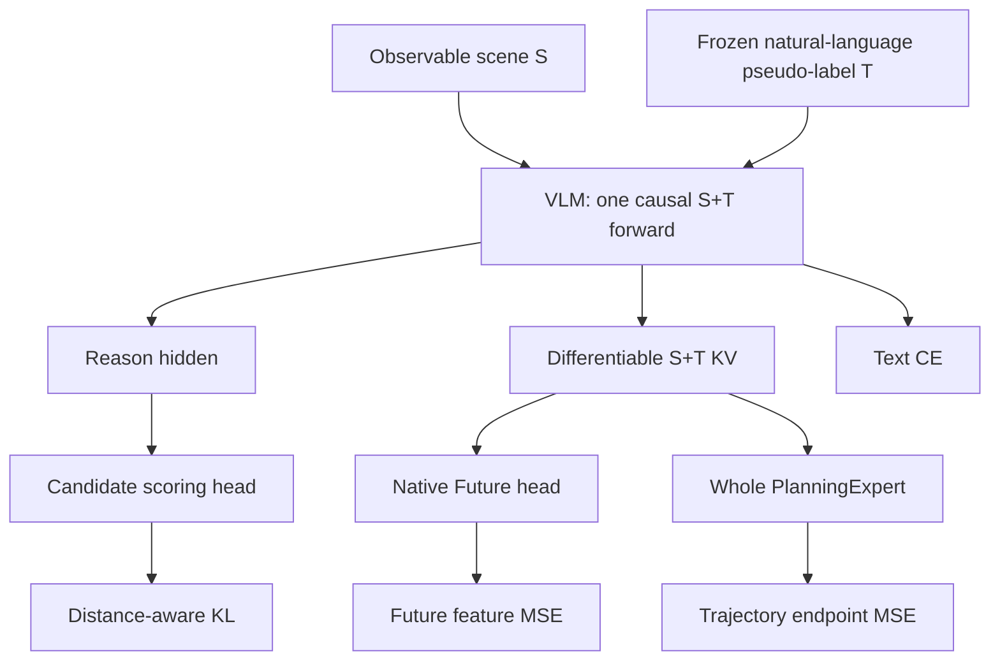

# Current interfaces and gradient flow

No `FuturePlanningMemory`, extra Future tokens, shifted Planning anchor, image decoder, latent-store reader, learned trajectory embedding or discrete behaviour-token loss remains.

- `ThreeBranchSystem.condition(sequence, inputs, language, candidate_features=None, candidate_valid=None)` runs the shared forward. It has no supervision argument. Both consumers use the same KV tensor objects, without clone/detach. Candidate scores are optional for planning inference.
- `ThreeBranchSystem.losses(condition, inputs, language, supervision, noise, flow_time, weights)` owns target access. Supervision has `q`, `candidate_valid`, `future_features`, `trajectory` and `trajectory_valid`.
- `ThreeBranchSystem.sample(condition, inputs, noise)` samples a trajectory without GT. `condition` can be built from S plus generated natural-language T; the current CLI implements teacher-forced training and also supports autoregressive prediction and held-out evaluation.
- `NativeFutureTargets.encode_scene(pairing, image_root)` calls only the frozen visual tower on future GT images, online. It never performs a second main text VLM forward.
- `planning_supervision` calls official `PlanningExpert.predict_endpoint`, using `x_t=(1-t)noise+t normalized_GT`. This GT-derived noisy input is local to the training denoiser.

| Loss | Parameters receiving its gradient |
|---|---|
| text CE | VLM LoRA |
| Reason KL | VLM LoRA + Reason scoring head |
| Future MSE | VLM LoRA + Future head |
| Planning MSE | VLM LoRA + entire PlanningExpert |

The association is through shared **parameters**: Future and Planning gradients travel through the shared KV activations and meet at LoRA. The optimizer updates LoRA, then the next forward produces new KV. There is no in-place training update of a persistent KV database and no gradient from Planning loss into Future-head weights.

Checkpoint format is `qwendrive_three_branch_shared_kv_v3`. It saves all trainable components, optimizer state and Torch RNG. A checkpoint from the removed direct-connector architecture is rejected rather than partially loaded.

The shared sequence includes `im_end` plus the official newline tokens. Content-only
Reason hidden is pooled; text CE also predicts `im_end`. Closing tokens enter shared
K/V and determine the Planning/Future anchor. All trainable LoRA weights and optimizer
moments are FP32. Autoregressive prediction uses ordinary hybrid generation caches,
then a fresh full closed-turn forward with ExportCache; training still uses one main
forward. Validation is mode-preserving and Torch-RNG-preserving.
